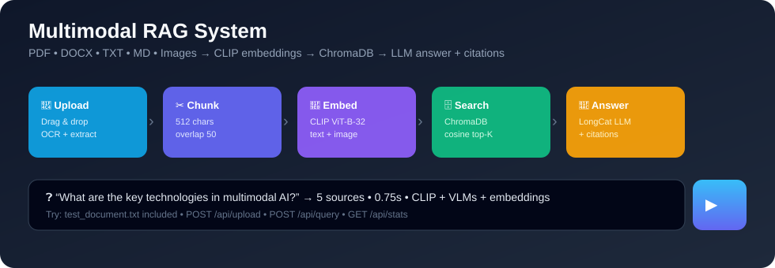
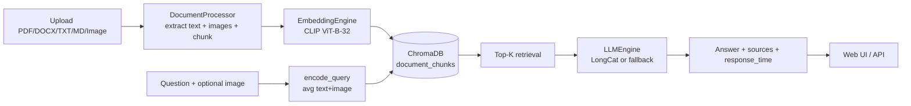
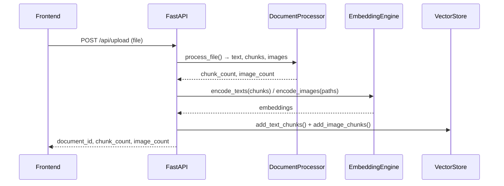
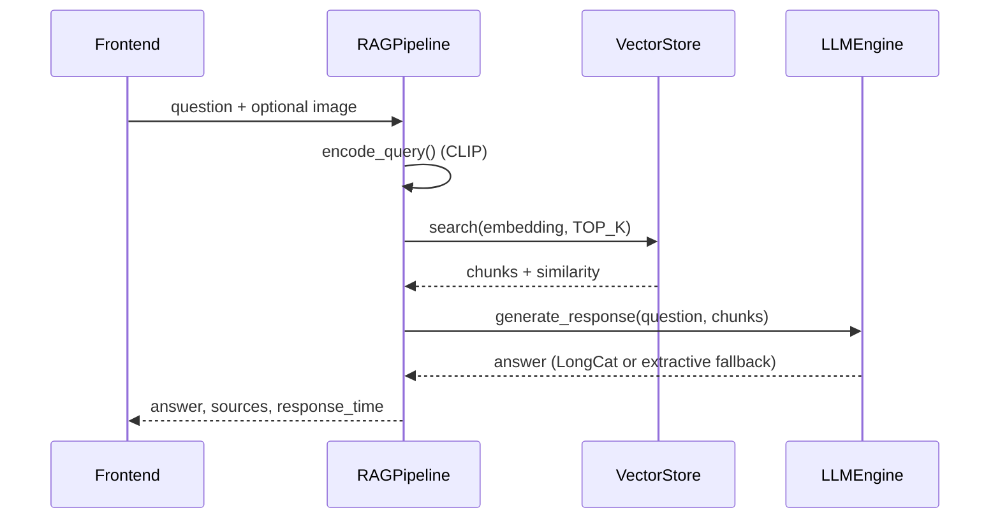

# 🧠 Multimodal RAG System


Upload **PDF, DOCX, TXT, MD and images** → get answers with **text + image understanding, sources and similarity scores**.



> Verified live run: `test_document.txt` → **5 chunks** → query *"What are the key technologies in multimodal AI?"* → **5 sources in 0.75s**, answer correctly retrieves **CLIP, VLMs, multimodal embeddings**.

---

## ✨ What it does

| Capability | Details |
|---|---|
| 📄 **Document ingestion** | PDF (PyMuPDF, text + embedded images), DOCX, TXT, MD, PNG/JPG/TIFF/BMP/WEBP |
| 🔍 **OCR** | Tesseract for image-only content (`TESSERACT_CMD`, `OCR_LANG`) |
| ✂️ **Chunking** | Overlapping windows — default `CHUNK_SIZE=512`, `CHUNK_OVERLAP=50` (via `.env`) |
| 🧠 **Multimodal embeddings** | `sentence-transformers/clip-ViT-B-32` — text **and** images in one space |
| 🗄️ **Vector search** | ChromaDB `document_chunks` collection, cosine, `TOP_K`, `SIMILARITY_THRESHOLD` |
| 💬 **Answers** | LongCat (`opencode/longcat-2.5-preview-free`) with graceful **extractive fallback** when API is offline |
| 🖥️ **Web UI** | Drag & drop sidebar, chat, image-augmented queries, source citations, stats, docs modal |
| 📚 **Citations** | Every answer returns `filename`, `chunk_type`, `similarity`, `content_preview` |

---

## 🏗️ How it works



**Ingest (`POST /api/upload` — `backend/main.py:64`):**



**Query (`POST /api/query` — `backend/main.py:152`, `backend/rag_pipeline.py:53`):**



Project map:

```
multimodal-rag/
├── backend/
│   ├── main.py              # FastAPI app, /api/* routes
│   ├── rag_pipeline.py      # orchestration: query() + ingest
│   ├── document_processor.py# PDF/DOCX/TXT/OCR + chunk_text()
│   ├── embedding_engine.py  # CLIP text/image encoder
│   ├── vector_store.py      # ChromaDB wrapper
│   ├── llm_engine.py        # LongCat + fallback
│   ├── config.py            # pydantic-settings (.env overrides)
│   └── requirements.txt
├── frontend/ index.html, app.js, styles.css
├── docs/architecture.svg
├── test_document.txt        # 5-chunk demo file
├── start.py / start.bat
└── data/ uploads/           # local only — gitignored
```

---

## 🚀 Quick start

**Prereqs:** Python 3.10+, Tesseract OCR ([Windows installer](https://github.com/UB-Mannheim/tesseract/wiki)), Mac `brew install tesseract`, Linux `sudo apt install tesseract-ocr`.

```bash
cd multimodal-rag
python -m venv venv
# Windows:
venv\Scripts\activate
# Mac/Linux:
# source venv/bin/activate

pip install -r backend/requirements.txt
cp .env.example .env   # add keys / paths
python start.py         # → http://localhost:8001
```

> `start.py` reads `HOST`/`PORT` from `config.py` + `.env` (default `8001`). API docs at `/docs`.

**Try it (verified):**

1. Open `http://localhost:8001` → drag `test_document.txt` into sidebar → expect `5 chunks`.
2. Ask: `What are the key technologies in multimodal AI?`
3. Expect sources with similarities ~`0.77–0.82` and answer mentioning **Vision-Language Models (CLIP, LLaVA), Multimodal Embeddings, LLMs (GPT-4, LongCat)**.

| Step | Result (live) |
|---|---|
| Document Upload | `test_document.txt` — 5 chunks, 0 images |
| Query | "What are the key technologies in multimodal AI?" — success |
| Answer | Correct — CLIP + VLMs + embeddings (extractive fallback when LongCat offline) |
| Sources | 5 found, similarities 0.769–0.816 |
| Response time | **0.75s** + ~6s one-time CLIP load |

---

## 🔌 API

| Method | Endpoint | Description |
|--------|----------|-------------|
| GET | `/` | Web UI |
| POST | `/api/upload` | Upload PDF/DOCX/TXT/MD/image → `{document_id, chunk_count, image_count}` |
| POST | `/api/query` | Form `question` + optional `image` → `{answer, sources, response_time, chunks_found}` |
| GET | `/api/documents` | List docs |
| DELETE | `/api/documents/{id}` | Delete doc + vectors |
| GET | `/api/stats` | `{vector_store, embedding_model, llm_model, chunk_size, ...}` |
| GET | `/api/health` | `{status, rag_ready}` |

```bash
# upload
curl -F "file=@test_document.txt" http://localhost:8001/api/upload
# query
curl -F "question=What are the key technologies in multimodal AI?" http://localhost:8001/api/query
# stats / health
curl http://localhost:8001/api/stats
curl http://localhost:8001/api/health
```

---

## ⚙️ Configuration (`.env`)

| Key | Default | Purpose |
|---|---|---|
| `LLM_MODEL` | `opencode/longcat-2.5-preview-free` | LongCat model (`.env` may override, e.g. `gpt-3.5-turbo`) |
| `EMBEDDING_MODEL` | `sentence-transformers/clip-ViT-B-32` | CLIP model |
| `CHUNK_SIZE` / `CHUNK_OVERLAP` | `512` / `50` | Chunking (`backend/document_processor.py:183`) |
| `TOP_K` / `SIMILARITY_THRESHOLD` | `5` / `0.3` | Retrieval (`backend/vector_store.py:70`) |
| `TESSERACT_CMD` / `OCR_LANG` | `C:\Program Files\Tesseract-OCR\tesseract.exe` / `eng` | OCR |
| `HOST` / `PORT` | `0.0.0.0` / `8001` | Server |

---

## 🖼️ UI preview

`frontend/index.html` — sidebar (upload, knowledge-base stats, settings showing `CLIP ViT-B-32` + `LongCat 2.5 Preview`), main chat with suggestions, image-button for visual questions, sources modal, toasts. No build step — served via `StaticFiles` at `/static` (`backend/main.py:54`).

> Add screenshots to `docs/` and link them here, e.g. `` ``.

---

## 🧪 Notes / limits

- First query pays CLIP download + load (~6s, cached after).
- Without LLM API key / network, `llm_engine.py:112` `_fallback_generate()` returns top overlapping passages — still cites sources.
- `data/` and `uploads/` are gitignored; `test_document.txt` at repo root is the canonical demo.
- `fix_frontend.py` is a one-off patch script (query now sends JSON/form correctly) — safe to delete after applying.

## License

MIT
